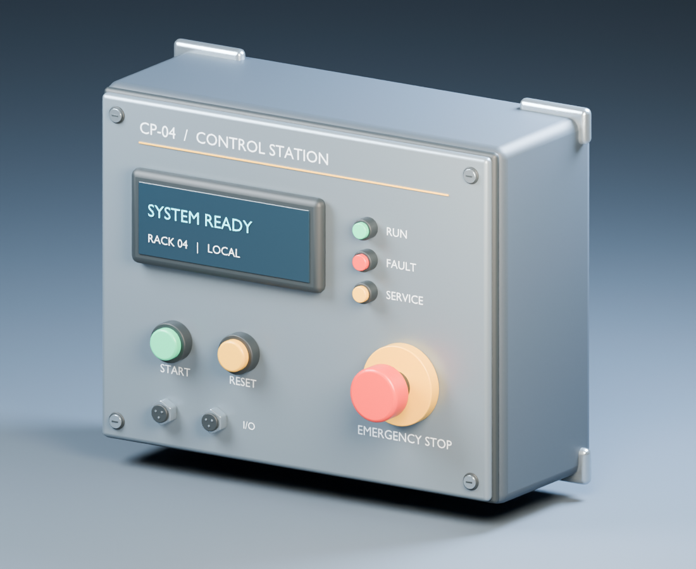

# CP-04 Industrial Control Panel

A 3D control station designed for a fictional data centre rack. The assembly includes a removable fascia, perimeter gasket, status indicators, service connectors, and an emergency-stop control. This is a visual asset for equipment-room scenes.

**Created November 15, 2026** with Blender 4.5.15 LTS, Blender Python, and Cycles. The model, material setup, and evidence in this version were generated with Codex from the portfolio owner's project brief.



[Front elevation](renders/front.png) · [Control detail](renders/close-up.png) · [Wireframe](renders/wireframe.png) · [Fascia UVs](renders/uv-fascia.svg) · [Enclosure UVs](renders/uv-enclosure.svg)

## Open the asset

- Open [CP-04.blend](assets/CP-04.blend) in Blender 4.5 LTS. The coatings are packed in the file. Select the fascia or enclosure and open **UV Editing** to inspect the editable UVs. The enclosure and fascia use base-mesh UV islands and editable bevel modifiers.
- Import [CP-04.glb](assets/CP-04.glb) into a glTF 2.0 viewer or engine. The GLB includes the panel assembly and embeds its textures. The studio cameras, floor, and lights are in the Blender file.
- The [texture files](textures/) include 4096 × 4096 base colour, roughness, and metallic PNGs for the powder-coated enclosure. The metallic map is black because the coating is dielectric. The other materials use Principled BSDF values. There is no baked normal map.

## Rebuild and verify

Run these commands from the repo root with Blender 4.5 on your PATH. The first command recreates the model, textures, GLB, and evidence images. The second reopens the Blender file and reimports the GLB.

```sh
blender -b --python-exit-code 1 --python tools/build_panel.py -- --output .
blender -b --python-exit-code 1 --python tools/verify_export.py -- --root .
```

[Example verification output](reports/export-verification.json) shows the Blender round-trip results, including mesh count, material names, packed image resolution, and world-space bounds. The test checks dimensions to 0.1 mm. Engine integration is pending.

The wireframe is a Blender render of the evaluated geometry. The UV diagrams are drawn directly from the editable base-mesh UV data.
